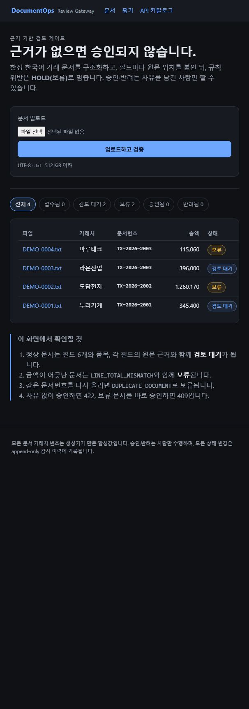
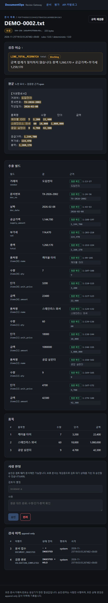
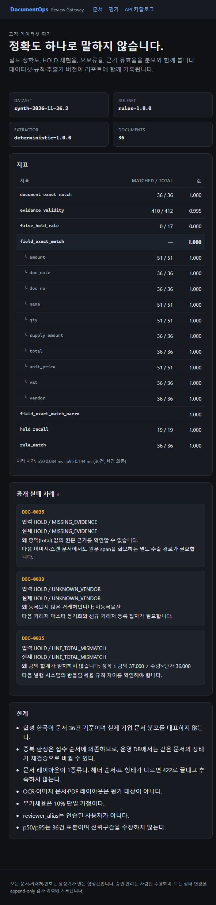

# DocumentOps Review Gateway

[](https://github.com/junwoo1206112/documentops-review-gateway/actions/runs/45697512065)

> 합성 한국어 업무 문서를 **원문 근거 → 규칙 검증 → 사람 승인 → 감사 이력 → 공개 평가** 흐름으로
> 안전하게 처리하는 포트폴리오 프로젝트입니다.

증명하려는 역량은 "AI가 답을 낸다"가 아니라,
**AI 산출물을 실제 업무에 투입하기 전에 검증·보류·승인·추적하는 방법**입니다.

**상태: Phase 0~12·14·14-I·15·17·17-I 완료** (계약 → 데이터 → 추출·검증 → 검토 UI/감사 → 평가 → Docker/CI → 운영·접근성 → 데모 공개 → 사람·품목 수정 → 두 번째 레이아웃 → LLM 계약 하네스 → 평가 증거 격리).
원격 CI·배지와 56.8초 데모 영상 공개를 완료했고, Gate A 결정에 따라 **원문 재인용 필드 수정**을 추가했습니다.
레이아웃별 평가 리포트를 분리해 `/evaluation`에서 함께 확인할 수 있습니다. 남은 것은 OCR·실제 LLM·운영화 Gate입니다. 실제 LLM·인증은 의도적으로 보류했고,
[보류 결정](docs/decisions/pending.md)에 근거를 남겼습니다.



## 핵심 계약 (바뀌지 않는 3가지)

1. **근거 없는 값은 승인될 수 없다.** 모든 추출 필드는 `page / char_start / char_end / evidence_excerpt`를 가진다.
2. **blocking 검증 오류가 1건이라도 있으면 `HOLD`다.** 자동 승인 경로는 존재하지 않는다.
3. **승인·반려는 사람만, 사유와 검토자 별칭을 필수로 남긴다.** 모든 상태 변경은 append-only 감사에 기록된다.

## 60초 데모

[공개 데모 영상 다운로드 (WebM, 5.58MB)](https://github.com/junwoo1206112/documentops-review-gateway/releases/download/v0.1.0-demo/documentops-demo.webm) · [Release v0.1.0-demo](https://github.com/junwoo1206112/documentops-review-gateway/releases/tag/v0.1.0-demo) (2026-11-26)

| # | 행동 | 확인할 결과 |
|---|---|---|
| 1 | `DEMO-0001.txt` 업로드 | 필드 6개 + 품목 2행, 각 값의 원문 span. 상태 `PENDING_REVIEW` |
| 2 | `DEMO-0002.txt` 업로드 | `LINE_TOTAL_MISMATCH` 1건, 상태 `HOLD`. 승인 버튼 비활성 |
| 3 | `DEMO-0003.txt` → `DEMO-0004.txt` | 둘째 문서가 `DUPLICATE_DOCUMENT`로 `HOLD`, `duplicate_of` 표시 |
| 4 | 정상 문서에 별칭+사유 입력 후 승인 | 상태 `APPROVED`, 감사 이벤트 3건(접수·검증·판정) |
| 5 | 사유 없이 승인 / `HOLD` 직접 승인 | 각각 422 / 409 |

```bash
python scripts/seed_demo.py     # 4건을 위 순서대로 접수 (서버 실행 중일 때)
```

### 접근성

- 첫 Tab으로 `본문으로 건너뛰기`, 현재 필터는 `aria-current`, 표는 `scope`/`caption`,
  폼 오류는 `role="alert"`로 알린다. 키보드 첫 포커스는 브라우저에서 확인했다.
- 자동 점검 완료: 주요 6개 색 조합은 WCAG AA 일반 텍스트 기준을 통과했고, 768px·1024px
  캡처에서 레이아웃을 확인했고, Windows Narrator로 업로드→HOLD→정상 승인→감사 이력 흐름을 사람 청취로 완료했다.

### 필드 수정 (Phase 14)

- `HOLD` 문서에서 **원문에 실제로 있는 문구를 재인용**해야만 값을 고칠 수 있다. 원문에 없는 값은
  만들 수 없고, 누락 필드는 원문을 고쳐 새로 업로드해야 한다.
- 수정하면 즉시 재검증되지만 자동 승인은 없다. 승인은 별도 사람 판정이다.
- 수정 전/후 값·근거 span·검토자·사유는 append-only로 남고, 추출 원본(`fields`)과
  수정 반영 값(`effective_fields`)을 분리해 보존한다.
- 범위: 스칼라 필드 6개와 기존 품목 행의 단일 셀(`name`·`qty`·`unit_price`·`amount`)이다.
  품목 행 추가·삭제·재정렬, 원문에 없는 값 생성, 자동 금액 보정은 재업로드가 필요한 비범위다.
- 결정 근거: [ADR 0003](docs/adr/0003-human-correction.md)

### 원문 근거와 보류 사유



- 왼쪽: 업로드 원문. 검증된 span만 노란색으로 표시한다.
- 오른쪽: 필드별 정규화 값·근거 상태(`원문 확인`/`파생값`/`근거 없음`)·span 좌표·발췌문.
- 아래: blocking 이슈, 품목, 사람 판정 폼, append-only 감사 이력.

### 공개 평가



## 측정된 기준선

기존 공백 표 `fixtures/evaluation` 36건과 파이프 표 `fixtures/evaluation_layout2` 36건을
분리해 평가합니다(`dataset_version=synth-2026-11-26.3`). 두 레이아웃 모두 아래 기준선을 재현합니다.
리포트는 서로 덮어쓰지 않도록 **레이아웃별 파일**로 저장되고, `/evaluation`은 두 리포트를 함께 보여 줍니다.

| 지표 | 값 | 분모 |
|---|---|---|
| 문서 완전 일치 | 36 / 36 | 36건 |
| HOLD 재현율 | 19 / 19 | HOLD 19건 |
| 오보류율 | 0 / 17 | 검토 대기 17건 |
| 규칙 일치 | 36 / 36 | 36건 |
| 근거 유효율 | 410 / 412 | 해석된 필드 412개 |
| 규칙 회귀 | 0건 | — |

- 필드 EM은 10개 필드 모두 1.000이다(품목 셀 포함 51/51).
- 근거 유효율의 부족 2건은 **의도된 파생 총액**이다. 값은 맞지만 원문 span이 없어 `HOLD`다.
- p50/p95는 환경 의존이므로 README의 성과 수치로 쓰지 않는다. `artifacts/evaluation_report*.json`에만 남긴다.
- 리포트는 `dataset_name`으로 구분한다: `evaluation`, `evaluation_layout2`.
- 자동 승인되지 않은 대표 사례 3건과 한계 7개를 `/evaluation`과 [docs/evaluation.md](docs/evaluation.md)에 공개한다.

## 아키텍처

```text
합성 .txt 문서 업로드
  → Ingestion        파일 SHA-256, UTF-8 검증, 크기 제한
  → Extraction       기본 결정론 파서 (선택형 오프라인 LLM 계약 스텁은 같은 인터페이스 뒤)
  → Evidence Mapper  필드별 원문 span 검증 (verified / derived / missing)
  → Validation       8개 명시 규칙 → blocking issue
  → Review Queue     HOLD 또는 PENDING_REVIEW
  → 사람 판정         승인 / 반려 + 별칭 + 사유
  → Audit + Eval     SQLite append-only, 고정 데이터셋 리포트
```

| 구성 요소 | 책임 | 금지 사항 |
|---|---|---|
| `app/services/ingestion.py` | 해시·인코딩·크기 검증 | 원문 수정 |
| `app/services/extraction/` | 스키마 후보 값과 span | 상태 변경 |
| `app/services/validation.py` | 명시 규칙으로 HOLD 사유 생성 | 모델 판단을 규칙처럼 위장 |
| `app/services/review.py` | 사람 판정·재검증·감사 기록 | 자동 승인 |
| `app/evaluate.py` | 고정 데이터셋 지표 | 운영 데이터 혼합 |

## 실행

Windows에서는 [scripts/run_local.cmd](scripts/run_local.cmd)를 더블클릭하면 독립 창에서 서버를 유지할 수 있습니다.
사이트를 사용하는 동안 그 창을 닫지 마세요.

```bash
python -m venv .venv
.venv\Scripts\activate              # Windows
# source .venv/bin/activate         # Linux/macOS
pip install -e ".[dev]"

python -m pytest -q                 # 174 passed (2026-11-27, Python 3.12.10)
python tools/generate_dataset.py --check
python -m app.inspect fixtures/evaluation/DOC-0001.txt

uvicorn app.asgi:app --reload       # http://127.0.0.1:8000
python scripts/seed_demo.py
python -m app.evaluate --dataset fixtures/evaluation --report artifacts/evaluation_report.json
python -m app.evaluate --dataset fixtures/evaluation_layout2 --report artifacts/evaluation_report_layout2.json
```

### Docker

Docker Desktop(또는 Docker Engine)이 실행 중이어야 합니다.

```bash
docker compose up --build
# http://127.0.0.1:8000  (health: healthy)
docker compose exec -T gateway python -m app.evaluate --dataset fixtures/evaluation \
  --report artifacts/evaluation_report.json
docker compose exec -T gateway python -m app.evaluate --dataset fixtures/evaluation_layout2 \
  --report artifacts/evaluation_report_layout2.json
```

확인한 사실(2026-11-27): 비루트 사용자(uid 10001), 헬스체크 `healthy`, 두 레이아웃 리포트가
이미지에 포함되어 `/evaluation`에서 함께 보인다. SQLite는 named volume에 유지된다.

### 공개 읽기 전용 데모(Render)

**공개 URL:** [documentops-review-gateway-demo.onrender.com](https://documentops-review-gateway-demo.onrender.com)

루트의 `render.yaml`은 무료(`free`) Docker 웹 서비스와 `/api/health` 헬스체크를 정의한다. Render에서 이 저장소를
Blueprint로 연결하면 `PUBLIC_DEMO_READ_ONLY=true`가 적용되어 외부 사용자의 업로드·수정·재검증·판정 요청은
403으로 차단된다. 빈 공개 DB에는 버전 관리되는 합성 데모 4건이 자동으로 준비되며, 화면에서도 쓰기 폼을
숨긴다. 공개 방문자는 합성 데이터 고지, 검증·감사 화면, Release 데모 영상을 볼 수 있다.

- 2026-11-26: 공개 URL에서 health `ok`, 문서 4건, 쓰기 차단 403을 확인했다.
- 2026-11-27: 재확인 시 `/api/health`가 **503**이었다. 재배포 후 health·목록 4건·POST 403·`/evaluation`
  두 리포트를 다시 확인하기 전까지 "live"로 주장하지 않는다. 무료 인스턴스는 비활성 후 재기동 시 첫 응답이 늦을 수 있다.

### CI

`.github/workflows/ci.yml`이 다음을 실행하도록 정의되어 있습니다.

1. `pip install -e ".[dev]"`
2. `ruff format --check .`
3. `ruff check .`
4. `python tools/generate_dataset.py --check`
5. `python -m pytest -q`
6. 두 레이아웃 `python -m app.evaluate …` 후 `artifacts/evaluation_report*.json` artifact 업로드

[`ci` 워크플로 첫 실행](https://github.com/junwoo1206112/documentops-review-gateway/actions/runs/45697512065)이
`main`에서 성공했습니다. 두 번째 레이아웃 평가 단계는 Phase 17-I에서 추가했으며, 다음 push에서 실행을 확인한다.

## 데모 영상 촬영

56.8초 연속 녹화본(WebM, 1280×720)은 실제 UI로 자동 생성·프레임 검수한 뒤
[GitHub Release v0.1.0-demo](https://github.com/junwoo1206112/documentops-review-gateway/releases/tag/v0.1.0-demo)에 공개했습니다.
실제 UI·API 차단 장면, 전용 격리 DB 실행법, 자막과 공개 전 체크리스트는
[DocumentOps 데모 촬영 가이드](docs/reference/DOCUMENTOPS_DEMO_RECORDING.md)에 고정했습니다.
asset SHA-256은 Release 화면에서 확인할 수 있습니다.

## API 요약

| Method | Path | 설명 |
|---|---|---|
| GET | `/api/health` | 상태·버전 |
| GET | `/api/meta` | 버전, 필드·규칙 카탈로그 |
| POST | `/api/documents` | 업로드(`multipart/form-data`, `file`) → 201 |
| GET | `/api/documents` | 목록(`status`, `limit`, `offset`) |
| GET | `/api/documents/{id}` | 필드·이슈·판정·감사·원문 |
| POST | `/api/documents/{id}/revalidate` | 규칙 재검증 |
| POST | `/api/documents/{id}/decision` | `{decision, reviewer_alias, reason}` |
| GET | `/api/documents/{id}/audit` | append-only 감사 이력 |
| GET | `/api/evaluation/latest` | 최신 평가 리포트 |

오류 본문은 항상 `{"error": {"code", "message", "details?"}}` 형식입니다.
OpenAPI는 `/api/openapi.json`에서 확인할 수 있습니다.

## 검증 규칙 (8개, 모두 blocking)

`MISSING_REQUIRED`, `INVALID_DOC_NO`, `INVALID_DATE`, `INVALID_MONEY`,
`LINE_TOTAL_MISMATCH`, `DUPLICATE_DOCUMENT`, `UNKNOWN_VENDOR`, `MISSING_EVIDENCE`

- 상위 원인이 있으면 하위 검사를 건너뛴다(연쇄 억제). 예: `INVALID_MONEY`인 공급가액은
  합계 검사에 쓰지 않는다.
- 상태 전이: `INGESTED → PENDING_REVIEW | HOLD`, `HOLD → PENDING_REVIEW | REJECTED`,
  `PENDING_REVIEW → APPROVED | REJECTED | HOLD`. **`HOLD → APPROVED`는 금지**다.
- 상세 계약: [docs/rules.md](docs/rules.md), [docs/schema.md](docs/schema.md)

## 데이터·범위 정책

- 실제 고객 문서, 주민번호·계좌·연락처 등 개인정보를 **사용하지 않는다.** 모든 값은 생성기가 만든 합성값이다.
- 외부 LLM API 키 없이, 네트워크 없이 테스트와 평가가 재현된다.
- `EXTRACTION_PROVIDER=llm-contract-stub`은 실제 LLM이 아닌 오프라인 계약 검증용이다. 기본값은
  `deterministic`이며, 모든 결과는 기존 원문 span 검증을 통과해야 한다.
- **비목표**: 실제 업무 실행(메일·결제·ERP), 자동 승인, 로그인·권한·멀티테넌시,
  실제 OCR 정확도 주장, PDF 레이아웃 일반화.
- OCR은 MVP 범위가 아니다. [ADR 0001](docs/adr/0001-text-first.md)과
  [보류 결정 P-001](docs/decisions/pending.md)을 참고한다.

## 알려진 한계

- 합성 문서 레이아웃은 공백 표와 파이프 표 2종뿐이다. 두 계약 밖의 헤더 순서나 표 형태는 추측하지 않고 422로 끝낸다.
- 중복 판정은 접수 순서에 의존한다. 반려 후 재검증으로 상태가 바뀔 수 있다.
- `reviewer_alias`는 인증 수단이 아니다. 승인은 "누가"가 아니라 "어떤 별칭이 어떤 사유로"만 남긴다.
- SQLite 단일 파일·단일 프로세스 전제다. 다중 인스턴스는 [ADR 0002](docs/adr/0002-stack.md)에서 제외했다.

## 문서

| 문서 | 내용 |
|---|---|
| [docs/schema.md](docs/schema.md) | 입력 형식, 필드, 상태 전이, DB/API 계약 |
| [docs/rules.md](docs/rules.md) | 8개 규칙, 심각도, 연쇄 억제 |
| [docs/evaluation.md](docs/evaluation.md) | 데이터셋 분리, 지표 정의·분모, 리포트 스키마 |
| [docs/security.md](docs/security.md) | 데이터 정책, 위협 모델, 배포 검증 |
| [docs/decisions/pending.md](docs/decisions/pending.md) | 보류 결정 5건 + P-003 결정 완료 기록 |
| [docs/ROADMAP_PHASES.md](docs/ROADMAP_PHASES.md) | 인수자·LLM 공용: Gate·수용 기준·권장 구현 순서 |
| [docs/reviews/](docs/reviews/) | Phase 0~12·14 전문가 A·B·C 교차 검증 기록 |
| [docs/reference/](docs/reference/) | 인수인계 원본 계획·실행 로그·데모 원고 |
| [HANDOFF.md](HANDOFF.md) | 인수자용: 현재 상태·검증 증거·남은 작업·재개 절차 |
| [handoff.seed.yaml](handoff.seed.yaml) | 기계 판독용 인수인계 상태(작업 ID·수용 기준) |

## 인수인계 원본

- [마스터 구현 계획](docs/reference/PORTFOLIO_IMPROVEMENT_MASTER_PLAN.md)
- [포트폴리오 실행 로그](docs/reference/PORTFOLIO_PHASE_LOG_20261125.md)
- [데모·사이트 원고](docs/reference/PORTFOLIO_DEMO_AND_SITE_COPY.md)


